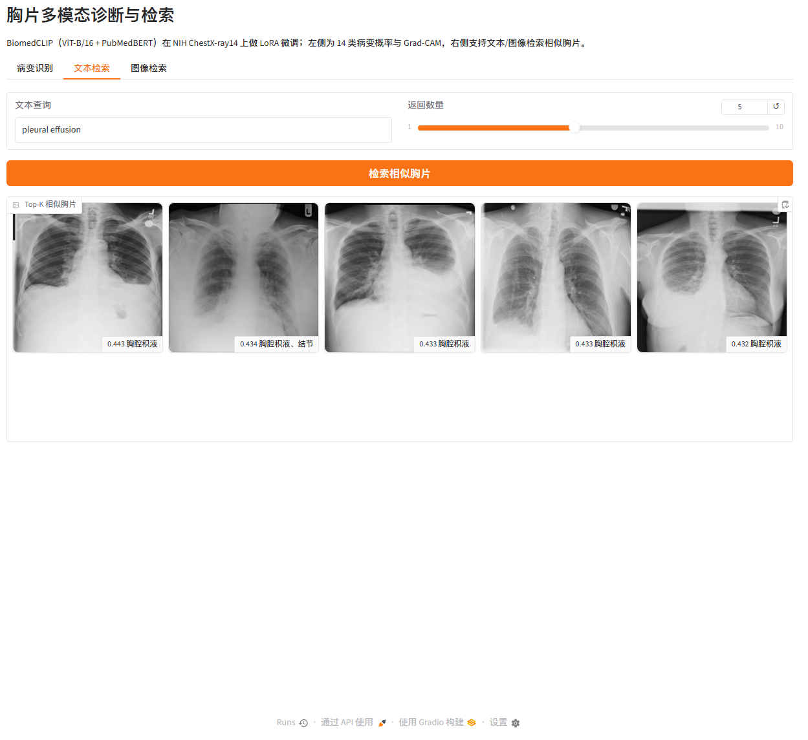

# 胸片多模态诊断与检索系统

基于 BiomedCLIP（ViT-B/16 + PubMedBERT）的胸片多标签分类与跨模态检索。在 NIH ChestX-ray14 的
24,999 张子集（6,585 名病人）上完成零样本、线性探针、LoRA 三档训练与 patient-level 评估，
同一套编码器同时支持 14 类病变预测、文本检索和图像检索，并提供 Gradio 界面与 FastAPI 接口。
训练、评估与推理均在单张 RTX 5060 Ti 16 GB 上完成，模型权重可离线加载。

A chest X-ray pipeline built on BiomedCLIP: 14-label classification with Grad-CAM, text-to-image and
image-to-image retrieval over FAISS, three training levels (zero-shot, linear probe, LoRA), patient-level
splitting, Gradio UI and FastAPI. Everything runs offline on one 16 GB consumer GPU.

## 结果

评估集为 patient-level 划分中的 test 集，5,473 张图片。

| 方案 | 可训练参数 | mean AUC | mean AP | 训练耗时 | 显存峰值 |
| --- | --- | --- | --- | --- | --- |
| 零样本（14 类 × 3 模板，减正常锚点） | 0 | 0.683 | 0.095 | — | — |
| 线性探针（512 → 14） | 7,182 | 0.729 | 0.129 | 约 2 min | < 1 GB |
| LoRA（qkv / proj，r=16） | 891,918（0.45%） | 0.743 | 0.140 | 约 4.6 min | 3.95 GB |

检索在 5,473 条向量上测 100 次查询，取 p50 延迟：Flat 0.34 ms、IVF-Flat 0.09 ms（Recall@10 0.969）、
HNSW 0.10 ms（Recall@10 1.000）。以标签重合计算，2,437 条含病变的查询在 Top-5 上的 recall 为 0.621。

## 功能

| 任务 | 输入 | 输出 | 实现 |
| --- | --- | --- | --- |
| 病变识别 | 一张胸片 | 14 类概率、Top-6、Grad-CAM 热力图 | LoRA 微调的 BiomedCLIP 加线性分类头 |
| 文本检索 | 病变名（`心脏扩大`、`pleural effusion`） | Top-K 相似胸片 | 文本塔编码，FAISS 内积检索 |
| 图像检索 | 一张胸片 | Top-K 相似胸片 | 图像塔编码，FAISS 内积检索 |

三档训练共用同一份划分、同一套手写指标与同一条评估流水线，因此三者之间的差值只反映训练方式，
不掺杂评估口径的差异。

## 界面


上传胸片后给出 14 类概率（Top-6 以条形图展示）、Grad-CAM 热力图与完整概率表。



输入病变名后返回 Top-5 相似胸片，每张图下方标注自身的金标准标签，便于核对检索结果与标注是否一致。

## 图表


按类别统计的 test AUC。心脏扩大 0.900、胸腔积液 0.819、气胸 0.720 较高；结节 0.661、
胸膜增厚 0.675 较低，与病灶尺寸和标注一致性有关。Hernia 在测试集中样本不足二十张，AUC 波动大，
不作单独引用。


线性探针在第 5 轮前后进入平台期，之后继续训练只增加过拟合。LoRA 三个 epoch 的验证集 AUC 为
0.735、0.755、0.757，第四个 epoch 开始下降。


上两行为图像检索，下两行为文本检索。图像检索返回的样本在体位与病灶形态上接近；文本检索的效果
取决于病变名是否具备可视觉化的形态，`cardiomegaly` 明显优于 `nodule`。


热区集中在肺野、膈面与图像边缘，而非病灶本身。这是 14×14 patch 分辨率的限制，因此该图在报告中
按可信度检查使用，不作为定位结果。

## 快速开始

### 只做推理

不训练时只需模型权重与推理资产，约 820 MB，不需要 12 GB 的训练数据。

```bash
git clone https://github.com/xLiii3/cxr-multimodal-retrieval && cd cxr-multimodal-retrieval

python -m src.setup --model          # 747 MB 权重，走 HF 镜像，支持断点续传
python -m src.setup --artifacts https://github.com/xLiii3/cxr-multimodal-retrieval/releases/latest/download/cxr-artifacts.zip
python -m src.setup --check          # 逐项检查缺失项
python app.py                        # http://127.0.0.1:7860
```

`cxr-artifacts.zip` 共 69 MB，含 LoRA 权重、检索索引与 5,473 张演示缩略图。只下载模型权重时可以
完成分类，检索页签没有底库。

| 用途 | 需要下载 | 体积 |
| --- | --- | --- |
| 只分类自己的胸片 | 模型权重 + `outputs/lora.pt` | 750 MB |
| 分类并检索自己的图库 | 上述文件 + 自己的图片目录 | 750 MB |
| 使用仓库发布的演示底库 | 模型权重 + `cxr-artifacts.zip` | 820 MB |
| 复现本文全部数字 | 上述文件 + NIH 子集 | 12 GB |

`data/raw/images` 中的原始 PNG 仅用于训练。推理时可以直接指向自己的图片目录：

```bash
python -m src.predict --images D:\my_xrays --cam --top 3   # 批量输出 CSV 与 Grad-CAM
python -m src.index --images D:\my_xrays                   # 用该目录重建检索底库，标签显示「未标注」
```

`src.predict` 为每张图打印一行 Top-1 结果，并把 14 类概率写入
`outputs/predictions/predictions.csv`，加 `--cam` 时同时保存热力图。

### 从零训练

```bash
# 环境：Windows + CUDA 12.8，sm_120 的显卡需使用 cu128 轮子
conda create -n cxr python=3.10 -y && conda activate cxr
pip install torch torchvision --index-url https://download.pytorch.org/whl/cu128
pip install -r requirements.txt

python -m src.fetch_data --shards 3          # 约 25,000 张，解压到 data/raw/images
python -m src.prepare --workers 8            # 标签解析、按病人划分、缩放为 224 的 memmap
python -m src.embed --batch 256              # 冻结骨干抽取 512 维特征，约 55 s

python -m src.zeroshot                       # 零样本基线
python -m src.train --stage linear           # 线性探针
python -m src.train --stage lora --epochs 3  # LoRA

python -m src.index                          # 三种 FAISS 索引与延迟/召回基准
python -m src.evaluate                       # 对比表、图表、随机划分消融
python -m src.explain                        # Grad-CAM

python app.py                                # Gradio
uvicorn api:app --port 8000                  # FastAPI，文档在 /docs
```

指标单测（手写实现与 sklearn 对拍）：

```bash
python -m tests.test_metrics
```

## 目录结构

```
cxr-multimodal-retrieval/
├── app.py                 # Gradio 三页签界面
├── api.py                 # FastAPI：/predict /search/text /search/image /health
├── src/
│   ├── config.py          # 路径、14 类、prompt 模板、归一化常数
│   ├── fetch_data.py      # 镜像下载与解压
│   ├── setup.py           # 下载模型权重、release 资产、数据集
│   ├── prepare.py         # 标签解析、patient-level 划分、memmap 预处理
│   ├── data.py            # Dataset 与 DataLoader
│   ├── model.py           # 模型加载、LoRA 注入、特征抽取
│   ├── embed.py           # 全量特征缓存
│   ├── metrics.py         # AUC / AP / Recall@K / ECE
│   ├── zeroshot.py        # 零样本基线
│   ├── train.py           # 线性探针与 LoRA
│   ├── predict.py         # 批量推理
│   ├── index.py           # FAISS 三索引与检索指标
│   ├── evaluate.py        # 对比表、图表、消融
│   ├── explain.py         # Grad-CAM
│   └── service.py         # 推理引擎，被 app 与 api 共用
├── tests/test_metrics.py  # 指标单测
├── examples/              # 演示用胸片
├── assets/                # README 与报告所用图表
├── docs/report.md         # 实验报告
├── outputs/               # 指标文件、权重、索引（大文件不入库）
└── requirements.txt
```

## 实现要点

### 数据划分

ChestX-ray14 中同一病人常有多张随访片。若按图片随机划分，同一病人的不同片子会同时进入训练集与
测试集，模型记住的是病人而非病变。本项目先对 `Patient ID` 去重并打乱（seed=42），按 7:1:2 切分
病人，再把每个病人的图片整体归入对应集合，得到 train 17,092 张、val 2,434 张、test 5,473 张。

对照实验使用同一套线性探针：随机按图片划分的 AUC 为 0.7629±0.0038（3 个种子），按病人划分为
0.7287，相差 0.034。消融实现在 `src/evaluate.py` 的 `ablation` 函数，结果写入
`outputs/ablation.json`。

### 多标签与损失

一张胸片可以同时有积液、心脏扩大与肺不张，14 类并非互斥，因此输出用 sigmoid 而非 softmax，
损失用 `BCEWithLogitsLoss`。各类阳性率从 0.24%（Hernia）到 14.86%（Infiltration），差 60 倍，
训练时按类别设置 `pos_weight = (N - pos) / pos`。

### 指标选择

阳性率差异使准确率失去意义：全部预测为无病即可得到约 85% 的准确率。评估以 per-class AUC 与 AP
为主，两者都不受类别先验影响；AP 对低阳性率类别更敏感，用于观察模型在稀有病变上的实际表现。

### 零样本锚点

14 个病变 prompt 与图像之间的相似度包含一个共同偏置，即「这本来就是一张胸片」。减去
`a normal chest x-ray` 的相似度后重新排序，mean AUC 从 0.573 升到 0.683，mean AP 从 0.077 升到
0.095。对照实现在 `src/zeroshot.py`，三种打分方式的结果存于 `outputs/zeroshot_anchor.json`。

### LoRA 的作用范围

只对视觉塔 12 个注意力块的 `qkv` 与 `proj` 加低秩旁路，r=16、alpha=16，可训练参数 891,918，
占 196.8M 的 0.45%，峰值显存 3.95 GB。训练集仅 1.7 万张，全量微调的过拟合风险高，因此选择冻结
其余权重。

### 指标实现

`src/metrics.py` 中的 AUC 与 AP 为纯 NumPy 实现：AUC 用 Mann-Whitney U 形式并对并列值取平均秩，
AP 采用非插值定义。`tests/test_metrics.py` 用 sklearn 在同一批随机数据上对拍至 1e-6，并单独测试
并列分数的处理。

## 离线部署

模型权重位于 `models/BiomedCLIP/`，不联网即可加载。需要注意两点：

1. `open_clip` 的 `local-dir:` 只覆盖视觉塔。文本塔仍会按 `hf_model_name` 去 huggingface.co 取配置，
   因此需要把 BiomedBERT 的 `config.json` 一并放入模型目录，并在加载时把 `text_cfg` 的
   `hf_model_name` 指向本地路径、设置 `hf_model_pretrained=False`。实现见
   `src/model.py` 的 `load_clip`。
2. 权重文件本身已包含文本塔参数，缺少的只是配置文件。

## 常见问题

**为什么不用 `sklearn.metrics.roc_auc_score`？**
sklearn 的实现用于对拍。手写版本的目的是确认对 AUC 与 AP 定义的理解：AUC 是随机取一正一负、
正样本得分更高的概率；AP 是非插值精度，逐个正样本处的 precision 取平均。

**LoRA 只提升 1.4 个百分点的 AUC，是否值得？**
单看 AUC 收益有限，其意义在于同一流水线下参数量从 196.8M 降到 0.89M 仍有提升，显存与时间成本
可控。若以更高指标为目标，应更换预训练更强的骨干（MedCLIP、CheXzero）并扩充数据。

**Grad-CAM 热区为什么不在病灶上？**
14×14 的 patch 网格决定定位精度约为 16 像素，模型也可能依赖整体肺野透亮度这类全局线索。
本项目的用法是检查模型是否关注了片子之外的内容，热区落在边框或标注文字上属于异常信号，
分析见 `docs/report.md` 第 7 节。

**Windows 下 `num_workers > 0` 为何卡死？**
Windows 使用 spawn 创建子进程，入口脚本缺少 `if __name__ == "__main__":` 会反复重启。
本项目所有 CLI 默认 `--workers 0`；数据已在 memmap 中，单进程吞吐足够。

**`data/raw/images` 的 11 GB 是否必需？**
仅重新训练时需要。推理依赖模型权重、`lora.pt` 与检索索引。自有胸片放入一个目录后即可通过
`python -m src.index --images <DIR>` 建立底库。

**release 中的 `cxr-artifacts.zip` 包含什么？**
`outputs/lora.pt`（3.4 MB）、`gallery_emb.npy`（10.7 MB）、`gallery_y.npy`、`index_flat.faiss`
（10.7 MB）、`gallery.csv` 与 `data/gallery/thumbs/*.jpg`（5,473 张 256 px 缩略图，42 MB）。
自行打包时按项目根目录的相对结构压缩上述路径，上传至 GitHub Releases。

## 参考

- BiomedCLIP: *BiomedCLIP: a multimodal biomedical foundation model pretrained from fifteen million scientific image-text pairs* (2023)
- NIH ChestX-ray14: Wang et al., *ChestX-ray8: Hospital-scale Chest X-ray Database and Benchmarks* (CVPR 2017)
- LoRA: Hu et al., *LoRA: Low-Rank Adaptation of Large Language Models* (ICLR 2022)

数据与权重的版权归各自作者，本仓库代码采用 MIT 协议。

## License

MIT © 2026 李原吉
