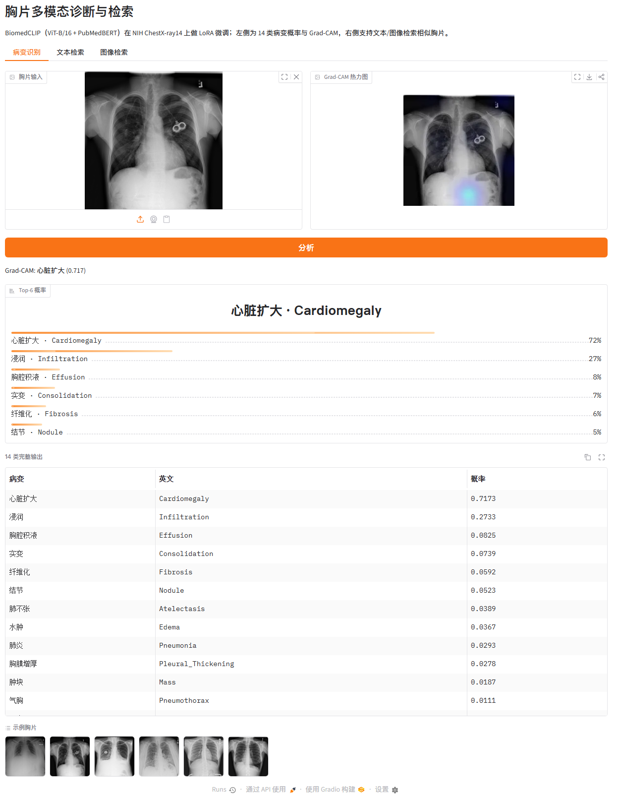
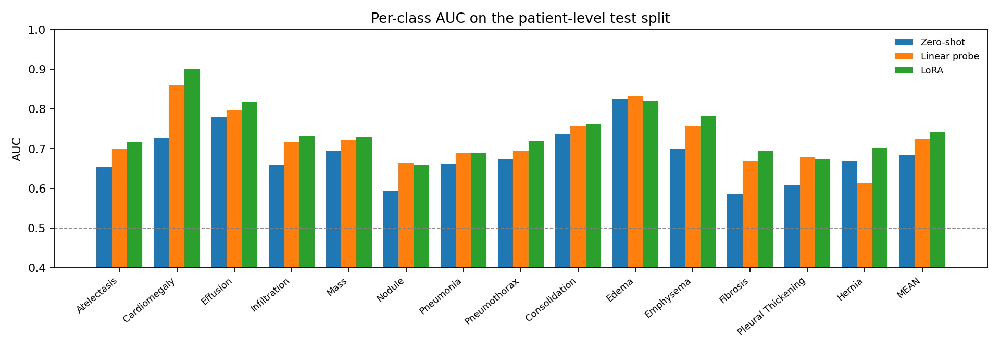
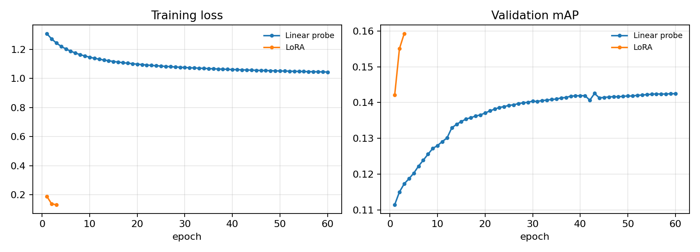
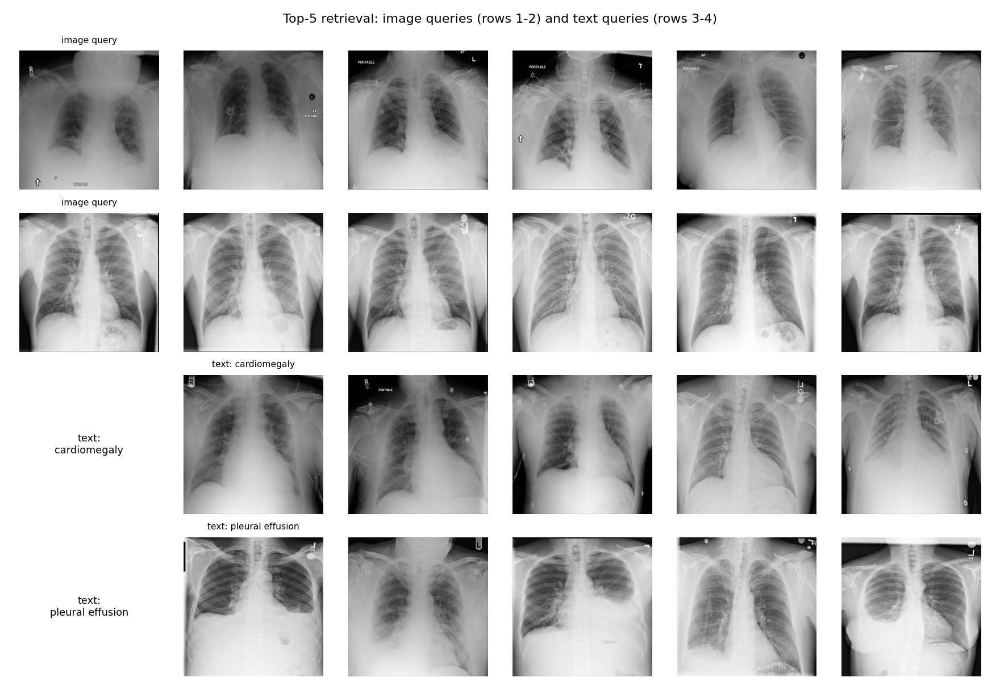
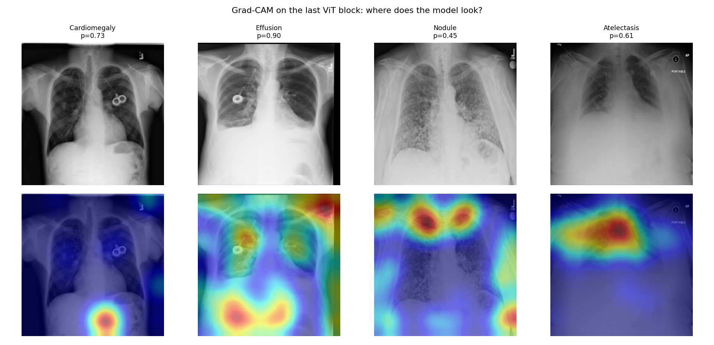

# 胸片多模态诊断与检索系统 · CXR Multimodal Diagnosis & Retrieval

[](https://github.com/xLiii3/cxr-multimodal-retrieval/releases)
[](LICENSE)

用 **BiomedCLIP**（ViT-B/16 + PubMedBERT）在 **NIH ChestX-ray14** 上做医学影像的多标签分类与跨模态检索：
一张胸片 → 14 类病变概率 + Grad-CAM；一句文本 / 一张图 → 从 5,473 张图库里检索最相似的胸片。
整个工程在单张 RTX 5060 Ti（16 GB）上从零训练、评估、服务化，全流程离线可复现。

> A self-contained, offline-reproducible chest X-ray pipeline: zero-shot → linear probe → LoRA fine-tuning of
> BiomedCLIP, patient-level evaluation, FAISS retrieval (3 index types benchmarked), Grad-CAM, Gradio UI and FastAPI.

| 指标（patient-level test, 5,473 张） | Zero-shot | Linear probe | LoRA |
| --- | --- | --- | --- |
| 可训练参数 | 0 | 7,182 | 891,918（0.45%） |
| mean AUC | 0.683 | 0.729 | **0.743** |
| mean AP | 0.095 | 0.129 | **0.140** |
| 训练耗时 | — | 约 2 min | 约 4.6 min（3 epoch） |
| 显存峰值 | — | < 1 GB | 3.95 GB |

三类病变的检索（FAISS，5,473 条向量，100 次查询）：Flat `0.34 ms`、IVF-Flat `0.09 ms`（Recall@10 0.969）、
HNSW `0.10 ms`（Recall@10 1.000）；按标签重合度算，Top-5 命中率 **62.1%**（2,437 条有病变的查询）。

---

## 1. 这个项目做了什么

| 功能 | 输入 | 输出 | 实现 |
| --- | --- | --- | --- |
| 病变识别 | 一张胸片 | 14 类病变概率 + Top-6 + 热力图 | LoRA 微调的 BiomedCLIP + 线性头 + Grad-CAM |
| 文本检索 | 一句文本（`心脏扩大` / `pleural effusion`） | Top-K 最相似胸片 | 文本塔编码 + FAISS 内积检索 |
| 图像检索 | 一张胸片 | Top-K 最相似胸片 | 图像塔编码 + FAISS 内积检索 |

**三级方案对照**是项目的骨架：先用零样本证明预训练特征本身可用，再用线性探针证明特征空间线性可分，
最后用 LoRA 说明「只训练 0.45% 参数也能再涨一截」。三者共用同一条评估流水线、同一份划分、同一套手写指标。

## 2. 界面



上传一张胸片 → 14 类概率（Top-6 用条形图展示）+ Grad-CAM 热力图 + 完整概率表。


输入 `pleural effusion` / `心脏扩大` → 从 5,473 张图库里返回 Top-5 最相似的胸片，并标出每张图自己的标签，
方便一眼看出"检回来的到底对不对"。

## 3. 效果









- **类别差异明显**：心脏扩大（0.900）、胸腔积液（0.819）、气胸（0.720）这类「形态明确、边界清晰」的病变好，
  结节（0.661）、胸膜增厚（0.675）这类「小目标、标注噪声大」的病变差。Hernia 在测试集里只有十几张，AUC 波动大，
  不建议单独引用。
- **训练曲线**：线性探针第 5 轮左右就进入平台期，之后再训只增加过拟合；LoRA 三个 epoch 的 val AUC
  0.735 → 0.755 → 0.757，继续训会掉（见 `docs/report.md` 的讨论）。
- **检索**：图像检索的 Top-5 在视觉上确实相似（同一体位、相近病灶）；文本检索更依赖标签词是否「可视觉化」，
  `cardiomegaly` 明显好于 `nodule`。
- **Grad-CAM**：热区偏全局（肺野、膈面、甚至边缘），**不是**精确的病灶定位。这是 14×14 patch 分辨率的固有限制，
  我在报告里把它写成「可信度检查」而不是「定位功能」。

## 4. 快速开始

**只想要能跑起来，不训练？** 三条命令，约 820 MB 下载量，不需要那 11 GB 数据集：

```bash
git clone https://github.com/xLiii3/cxr-multimodal-retrieval && cd cxr-multimodal-retrieval

python -m src.setup --model        # 747 MB 模型权重（走 HF 镜像，断点续传）
python -m src.setup --artifacts https://github.com/xLiii3/cxr-multimodal-retrieval/releases/latest/download/cxr-artifacts.zip
python -m src.setup --check        # 逐项核对，缺什么一目了然
python app.py                      # 打开 http://127.0.0.1:7860
```

`--artifacts` 那 69 MB 是 LoRA 权重 + 检索索引 + 5,473 张演示缩略图，解压即用；不下载它就只能分类，检索页签没有底库。

| 你的用途 | 需要下载 | 大约 |
| --- | --- | --- |
| 只分类自己的胸片 | 模型权重 + `lora.pt` | 750 MB |
| 连检索一起用（自带图库） | 上面 + 自己的图片文件夹 | 750 MB |
| 用我发布的演示底库 | 模型权重 + release 的 `cxr-artifacts.zip` | 820 MB |
| 复现 README 里的数字 | 上面 + NIH 子集（`--data`） | 12 GB |

`data/raw/images` 那 11 GB **只是训练用的原始数据**：推理时不需要，换用户自己的图片也能跑：

```bash
python -m src.predict --images D:\my_xrays --cam --top 3   # 批量出 CSV + Grad-CAM
python -m src.index --images D:\my_xrays                  # 用你自己的文件夹重建检索底库（标签显示「未标注」）
```

`src.predict` 每张图打印一行（Top-1 类别与概率），并把 14 类概率写成 `outputs/predictions/predictions.csv`，`--cam` 额外存热力图。

完整流程（从零训练）：

```bash
# 0) 环境（Windows + CUDA 12.8；sm_120 的卡必须用 cu128 轮子）
conda create -n cxr python=3.10 -y && conda activate cxr
pip install torch torchvision --index-url https://download.pytorch.org/whl/cu128
pip install -r requirements.txt

# 1) 数据：NIH ChestX-ray14（标签 CSV + 图像分片，走 HF 镜像，断点续传）
python -m src.fetch_data --shards 3        # 约 25,000 张，解压到 data/raw/images

# 2) 标签解析 + 按病人划分 + 统一缩放成 224×224 的 uint8 memmap
python -m src.prepare --workers 8

# 3) 冻结骨干，抽 512 维图像/文本特征（25,000 张约 55 s）
python -m src.embed --batch 256

# 4) 三级方案
python -m src.zeroshot                     # 零样本（14 类 × 3 模板 − 正常锚点）
python -m src.train --stage linear         # 线性探针
python -m src.train --stage lora --epochs 3  # LoRA（qkv + proj，r=16）

# 5) 检索索引 + 评估 + 可解释性
python -m src.index                        # 三种 FAISS 索引 + 延迟/召回基准
python -m src.evaluate                     # 对比表、三张图、泄漏消融
python -m src.explain                      # Grad-CAM

# 6) 服务
python app.py                              # Gradio  -> http://127.0.0.1:7860
uvicorn api:app --port 8000                # FastAPI -> /docs
```

单测（手写指标 vs sklearn 对拍）：

```bash
python -m tests.test_metrics
```

## 5. 目录结构

```
cv/
├── app.py                 # Gradio 三页签界面
├── api.py                 # FastAPI：/predict /search/text /search/image /health
├── src/
│   ├── config.py          # 路径、14 类、prompt 模板、归一化常数
│   ├── fetch_data.py      # 镜像下载 + 解压（断点续传）
│   ├── setup.py           # 一键下载：模型 / release 资产 / 数据集
│   ├── prepare.py         # 标签解析、patient-level 划分、memmap 预处理
│   ├── data.py            # Dataset / DataLoader / 在线预处理
│   ├── model.py           # BiomedCLIP 加载、LoRA 注入、特征抽取
│   ├── embed.py           # 全量特征缓存
│   ├── metrics.py         # 手写 AUC / AP / Recall@K / ECE
│   ├── zeroshot.py        # 零样本基线
│   ├── train.py           # 线性探针 + LoRA 微调
│   ├── index.py           # FAISS 三索引 + 检索指标
│   ├── evaluate.py        # 对比表、图表、随机划分消融
│   ├── explain.py         # Grad-CAM
│   └── service.py         # 推理引擎（被 app/api 共用）
├── tests/test_metrics.py  # 指标单测
├── examples/              # 演示用胸片（各病变一张）
├── assets/                # README / 报告用的图
├── docs/report.md         # 完整实验报告
├── outputs/               # 指标 JSON、权重、索引（git 忽略大文件）
└── requirements.txt
```

## 6. 几个关键决定

**按 Patient ID 划分，而不是按图片。** ChestX-ray14 同一个病人有多张片，随机划分会让同一病人的片子同时出现在
训练和测试集里，模型「见过这张脸」。实测：同一套线性探针，随机划分 AUC 0.7629±0.0038，按病人划分 0.7287，
**虚高 3.4 个点**。消融在 `src/evaluate.py::ablation`，3 个种子取均值。

**用 sigmoid 而不是 softmax。** 一张胸片可以同时有积液、心脏扩大、肺不张，14 类是**多标签**而不是互斥的 14 选 1。

**看 AUC / AP，不看准确率。** 阳性率从 0.24%（Hernia）到 14.9%（Infiltration）差 60 倍，全预测「无病」也能有
85% 的准确率。AP 更能反映低阳性率类别的真实水平。

**零样本要减掉「正常胸片」锚点。** 14 个病变 prompt 的相似度里都混着一个很强的「这本来就是张胸片」的共同偏置，
它会把类间差异压平。减去 `a normal chest x-ray` 的相似度后重新排序，mean AUC 从 **0.573 → 0.683**
（mean AP 0.077 → 0.095）。这个对照实验在 `src/zeroshot.py`，结果存 `outputs/zeroshot_anchor.json`。

**LoRA 只训 attention 的 qkv / proj。** r=16、alpha=16，可训练参数 891,918（占 196.8M 的 0.45%），
峰值显存 3.95 GB —— 16 GB 卡可以同时开着浏览器和 IDE 训练。全量微调在同样数据上大概率过拟合（训练集仅 1.7 万张）。

**手写指标再和 sklearn 对拍。** `src/metrics.py` 里的 AUC/AP 是纯 numpy 实现（Mann-Whitney U、非插值 AP），
`tests/test_metrics.py` 用 sklearn 在同一批随机数据上对到 1e-6，并单独测了并列值（tie）的处理。

## 7. 离线 / 内网部署

模型权重已经放在 `models/BiomedCLIP/`，不联网也能跑。两个坑：

1. `open_clip` 的 `local-dir:` 只解决视觉塔，文本塔仍会去 huggingface.co 拉配置 → 需要把 BiomedBERT 的
   `config.json` 也拷进模型目录，并把 `text_cfg` 的 `hf_model_name` 改成本地路径、`hf_model_pretrained=False`。
   见 `src/model.py::load_clip`。
2. 权重 `.bin` 里已经包含文本塔参数，所以**只缺 config**，不缺权重。

## 8. FAQ

**Q：为什么不用现成的 `sklearn.metrics.roc_auc_score`？**
A：可以用，而且我拿它做对拍。但我想验证自己真的理解 AUC = 随机取一正一负、正样本得分更高的概率，
以及 AP 的非插值定义（每个正样本处的 precision 取平均），所以手写了一版。

**Q：LoRA 只涨了 1.8 个点，值得吗？**
A：单看 AUC 不值。它的价值在「同一套流水线下，参数量从 196.8M 降到 0.89M 还能涨」，以及显存/时间成本可控。
如果目标是刷 SOTA，应该上更强的骨干（如 MedCLIP、CheXzero 的多数据集预训练）和更多数据。

**Q：Grad-CAM 热区为什么不在病灶上？**
A：14×14 的 patch 网格 + 全局注意力，定位精度本来就只有 ~16 px；而且模型可能依赖「整体肺野透亮度」这类全局线索。
我把它当「模型有没有看片子之外的东西」的检查工具，热区落在边框/文字标记上就是危险信号（见报告 §7）。

**Q：Windows 上 `num_workers>0` 卡死？**
A：Windows 用 spawn 起子进程，入口脚本没有 `if __name__ == "__main__":` 时会无限递归重启。
本项目所有 CLI 默认 `--workers 0`（数据已在内存 memmap 里，单进程足够快）。

**Q：`data/raw/images` 那 11 GB 必须吗？**
A：只有重新训练必须。推理要的是「模型权重 + `lora.pt` + 检索索引」；图像只是训练输入，
你自己的胸片放进一个文件夹就能建底库（`python -m src.index --images <DIR>`）。

**Q：release 里的 `cxr-artifacts.zip` 装了什么？**
A：`outputs/lora.pt`（3.4 MB）、`gallery_emb.npy`（10.7 MB）、`gallery_y.npy`、`index_flat.faiss`（10.7 MB）、
`gallery.csv`、`data/gallery/thumbs/*.jpg`（5,473 张 256 px 缩略图，42 MB）——解压即用，不碰训练数据。
自己打包：把上面这些路径按项目根目录的相对结构压成 zip，传到 GitHub Releases 即可。

## 9. 参考

- BiomedCLIP: *BiomedCLIP: a multimodal biomedical foundation model pretrained from fifteen million scientific image-text pairs* (2023)
- NIH ChestX-ray14: Wang et al., *ChestX-ray8: Hospital-scale Chest X-ray Database and Benchmarks* (CVPR 2017)
- LoRA: Hu et al., *LoRA: Low-Rank Adaptation of Large Language Models* (ICLR 2022)
- 数据与权重版权归各自作者；本仓库代码 MIT。

## License

MIT © 2026 李原吉
