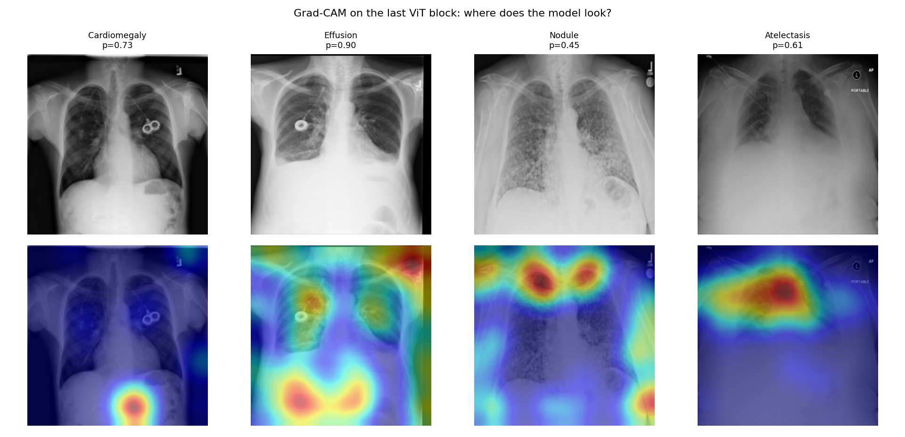

# 胸片多模态诊断与检索系统 · 实验报告

> 硬件：RTX 5060 Ti 16 GB / Ryzen / 32 GB RAM / Windows 11
> 软件：Python 3.10、PyTorch 2.11（cu128）、open_clip 4.2.2、FAISS 1.13（CPU）、Gradio 6.x
> 代码：`D:\cv`（本文所有数字都可由 §9 的命令复现）

---

## 1. 目标与约束

想验证一件事：**一个公开的医学多模态预训练模型（BiomedCLIP），在消费级显卡和 2.5 万张公开胸片上，
能做到什么程度的诊断与检索**，以及"做到什么程度"这件事能不能被严谨地度量。

三条硬约束决定了后面的技术选择：

1. **单卡 16 GB**。不能全量微调 196.8M 的双塔，只能走「冻结特征 + 轻量适配」的路线。
2. **数据只有 2.5 万张**（NIH ChestX-ray14 的一个子集）。相比官方 11.2 万张，过拟合风险更高，
   因此更需要严格的划分与正则。
3. **必须能离线跑**。医院/内网环境没有 huggingface，模型权重和配置都得落在本地。

## 2. 数据

### 2.1 来源与规模

NIH ChestX-ray14（Wang et al., CVPR 2017），标签来自 `Data_Entry_2017_v2020.csv` 的
`Finding Labels` 字段（用 `|` 分隔的多标签）。本实验取前 3 个图像分片：

| 项目 | 数值 |
| --- | --- |
| 图像数 | 24,999 |
| 病人数 | 6,585 |
| 图像格式 | PNG，原始 1024×1024 灰度 |
| 标签 | 14 类多标签（一图可多病）+ `No Finding` |

### 2.2 划分：按病人，不按图片

同一病人往往有多张随访片。按图片随机划分会让同一病人的不同片子分别落进训练集和测试集，
模型实际是在"认人"而不是"认病"。因此先对 `Patient ID` 去重、打乱（seed=42），按 **7:1:2** 切分，
再把每个病人的所有图片整体放进对应集合：

| 集合 | 图片数 | 病人数 |
| --- | --- | --- |
| train | 17,092 | 4,609 |
| val | 2,434 | 658 |
| test | 5,473 | 1,318 |

### 2.3 类别分布（全量 24,999 张）

| 病变 | 阳性率 | 病变 | 阳性率 |
| --- | --- | --- | --- |
| Infiltration | 14.86% | Emphysema | 1.90% |
| Effusion | 9.33% | Pneumonia | 1.15% |
| Atelectasis | 9.08% | Hernia | 0.24% |
| Nodule | 4.88% | 其他 8 类 | 2.2%–3.7% |

阳性率跨两个数量级（0.24% → 14.86%），这是后面坚持用 AUC/AP 而不是准确率的直接原因：
全部预测"无病"就能拿到约 85% 的准确率，但这个数字没有任何临床意义。

### 2.4 预处理

统一缩放到 224×224（BICUBIC），转成 `uint8` 的 `(N, 224, 224, 3)` memmap（约 3.7 GB），
训练时再按 CLIP 的 mean/std 归一化。这样做的收益是可测量的：24,999 张图预处理耗时 **53 s**（12 进程），
之后每个 epoch 的数据加载不再有解码开销。

## 3. 方法

### 3.1 骨干：BiomedCLIP 双塔

- 视觉塔：ViT-B/16，输入 224×224，输出 512 维（CLS token 经投影头）。
- 文本塔：PubMedBERT（12 层，768 隐层，词表 30,522），max length 256，输出 512 维。
- 两个塔输出经 L2 归一化后，内积即余弦相似度。

双塔的优势在于向量可以预计算：图库的 5,473 条图像向量只算一次并落盘，检索时仅编码 query，
这是引入 FAISS 的前提。

### 3.2 三级方案

| 级别 | 训练什么 | 目的 |
| --- | --- | --- |
| 零样本 | 不训练 | 证明预训练特征本身就带病变语义 |
| 线性探针 | 512→14 的线性层（7,182 参数） | 证明特征空间线性可分，排除"特征不行"的可能 |
| LoRA | attention 的 qkv/proj 低秩旁路 + 线性头（891,918 参数） | 证明轻度适配还能再涨，且成本可控 |

**零样本**：14 类 × 3 个 prompt 模板，分别编码后取平均得到类向量，图像向量与类向量做内积。
关键一步是减去「正常胸片」锚点：

```
score(c) = 100 · ( x · t_c  −  x · t_normal )
```

不减去锚点时，14 个类向量都带有很强的"这是一张胸片"的共同偏置，类间的排序被这个偏置稀释。
实测（同一批测试向量，只改打分方式）：

| 打分方式 | mean AUC | mean AP |
| --- | --- | --- |
| 直接内积 | 0.573 | 0.077 |
| 减去正常锚点 | **0.683** | **0.095** |
| 除以正常锚点 | 0.680 | 0.092 |

**线性探针**：冻结骨干，取缓存好的 512 维特征训练 `Linear(512, 14)`，`BCEWithLogitsLoss`。
两个必要的技巧：

- `pos_weight = (N − n_pos) / n_pos`，按类补偿阳性率差异，否则模型会倾向于全预测为负；
- 以**验证集 mean AUC** 早停（而不是训练 loss），因为 loss 会被大类主导。

学习率 1e-3、weight decay 1e-2、batch 256、最多 60 epoch，实际在第 30 轮左右收敛。

**LoRA**：对 ViT 12 个 block 的 `attn.qkv`（768→2304）和 `attn.proj`（768→768）各挂一个
秩为 16 的旁路 `W + (α/r)·BA`，A 用 kaiming 初始化、B 置零（保证初始等价于原模型）。
只训 LoRA 参数 + 线性头，AdamW（LoRA lr 2e-4、head lr 1e-3），OneCycle 调度，梯度裁剪 1.0。
3 个 epoch，峰值显存 3.95 GB，单 epoch 约 90 s。

### 3.3 手写指标并与 sklearn 对拍

`src/metrics.py` 用纯 numpy 实现了 AUC（Mann-Whitney U，并列值取平均秩）、非插值 AP、
Recall@K / Precision@K、Youden 阈值、敏感度/特异度、ECE。`tests/test_metrics.py` 在随机数据上
与 `sklearn.metrics` 对到 **1e-6**，并单独覆盖了并列值、K 大于相关项数等边界。

手写的目的在于把定义落到可解释的形式：AUC 是随机取一正一负、正样本得分更高的概率；
AP 是各正样本处 precision 的均值，不做插值。

## 4. 结果

### 4.1 三级方案对比（patient-level test，5,473 张）

| 方案 | 可训练参数 | mean AUC | mean AP |
| --- | --- | --- | --- |
| Zero-shot | 0 | 0.683 | 0.095 |
| Linear probe | 7,182 | 0.729 | 0.129 |
| LoRA | 891,918（0.45%） | **0.743** | **0.140** |

从零样本到线性探针 +4.5 个 AUC 点，说明预训练特征里确实有可线性读出的病变信息；
从线性探针到 LoRA 再 +1.4 点，说明适度的注意力适配能撬动更多。

### 4.2 分类别 AUC

| 病变 | 零样本 | 线性探针 | LoRA | LoRA AP |
| --- | --- | --- | --- | --- |
| Atelectasis | 0.654 | 0.701 | **0.716** | 0.224 |
| Cardiomegaly | 0.728 | 0.862 | **0.900** | 0.234 |
| Effusion | 0.781 | 0.795 | **0.819** | 0.347 |
| Infiltration | 0.660 | 0.719 | **0.731** | 0.315 |
| Mass | 0.694 | 0.719 | **0.729** | 0.159 |
| Nodule | 0.594 | **0.666** | 0.661 | 0.131 |
| Pneumonia | 0.662 | **0.698** | 0.689 | 0.026 |
| Pneumothorax | 0.675 | 0.700 | **0.720** | 0.101 |
| Consolidation | 0.736 | 0.760 | **0.762** | 0.138 |
| Edema | 0.824 | **0.831** | 0.824 | 0.070 |
| Emphysema | 0.699 | 0.767 | **0.783** | 0.065 |
| Fibrosis | 0.586 | 0.676 | **0.695** | 0.074 |
| Pleural_Thickening | 0.607 | **0.680** | 0.675 | 0.072 |
| Hernia | 0.667 | 0.626 | **0.701** | 0.007 |
| **均值** | **0.683** | **0.729** | **0.743** | **0.140** |

三点观察：

1. **形态明确的病变好学**：心脏扩大 0.900（心影轮廓）、胸腔积液 0.819（肋膈角变钝）、气胸 0.720（肺纹理消失）。
2. **小目标 + 标注噪声的病变难学**：结节 0.661、胸膜增厚 0.675。结节在 224×224 下可能只剩几个像素，
   而且 ChestX-ray14 的结节标签来自报告文本挖掘，本身噪声大。
3. **Hernia 不可引用**：测试集里只有十几张阳性，AUC 每次重训都会跳 ±0.1，只能当作"流程跑通了"的证据。

### 4.3 训练曲线

- 线性探针：val AUC 在第 5 轮就到 0.72 附近，之后缓慢爬升到 0.729，第 30 轮后开始抖动并轻微下降。
  说明 512 维特征上的线性问题是"低容量"的，训久了只会过拟合（训练集只有 1.7 万）。
- LoRA：三个 epoch 的 val AUC 为 0.735 → 0.755 → 0.757，val AP 0.142 → 0.155 → 0.159。
  第 3 轮之后继续训，val 指标开始回落（学习率调度已到尾声），因此停在 3 个 epoch。

## 5. 数据泄漏消融（本项目的核心结论之一）

拿**同一个**线性探针、同一份特征，只把划分方式从 patient-level 换成 image-level 随机划分（3 个种子）：

| 划分方式 | mean AUC（3 seed） |
| --- | --- |
| patient-level（正确） | 0.729 |
| image-level（错误） | 0.7629 ± 0.0038 |
| **虚高** | **+0.0342** |

同一个模型、同一份数据，仅改变划分方式就能让指标提高 3.4 个点。这也解释了部分胸片论文 AUC 达到
0.85 以上却无法复现的原因：其实验划分中混入了训练病人的片子。三种子方差为 ±0.004，说明差距不是噪声。

第一次做这个消融时只用了 1 个种子、20 个 epoch，得到 +0.0187，结论偏乐观。把 epoch 补到 60、
种子增至 3 个后数值才稳定，说明消融实验同样受统计功效限制。

## 6. 检索系统

### 6.1 图库与索引

图库 = 测试集 5,473 张（**不与训练集重叠**），向量由 LoRA 适配后的图像塔重新编码。
三种 FAISS 索引，100 次查询，单线程 CPU：

| 索引 | p50 | p95 | Recall@10（相对 Flat） |
| --- | --- | --- | --- |
| IndexFlatIP（精确） | 0.34 ms | 0.54 ms | 1.000 |
| IndexIVFFlat（nlist=74, nprobe=8） | **0.07 ms** | 0.09 ms | 0.969 |
| IndexHNSWFlat（M=32, efC=80, efS=64） | 0.09 ms | 0.10 ms | 1.000 |

在 5,473 条向量的规模上，精确检索的 p50 已降到 0.34 ms，IVF 与 HNSW 的收益要到百万级才明显。
保留三者对比的目的是给出换索引的判据，而非选择「最优」索引。

### 6.2 检索质量

用「共享至少一个病变标签」定义相关（排除自身），在 2,437 条**有病变**的测试查询上：

| 指标 | 数值 |
| --- | --- |
| Recall@5 | 0.621 |
| Precision@5 | 0.252 |

只统计有病变的查询是必要的：正常胸片之间互相检索会让指标失去意义（正常图占多数，
随便返回 5 张正常图就能拿到高分）。

文本检索的定性观察：`cardiomegaly`、`pleural effusion` 这类有明确视觉对应物的词汇，Top-5 基本同类；
`nodule` 这类小目标词容易混入正常片。该排序与 §4.2 的 AUC 结果一致，原因是分类与检索共用同一个
特征空间，强弱项也相同。

## 7. 可解释性：Grad-CAM

对 LoRA 模型最后一个 ViT block 的输出做 Grad-CAM（梯度对 token 取平均加权，去掉 CLS，14×14 上采样，
高斯平滑后叠在灰度图上），每类取测试集中该类的最高分样本：



热区并不落在病灶上。心脏扩大的热区落在心影与膈面，尚可对应；结节与肺不张的热区更多落在肺尖、
肺门乃至图像边缘。原因有三：

1. 分辨率：14×14 的 patch 网格，每格对应原图 16×16 像素，定位精度不足；
2. 注意力机制：ViT 的全局自注意力使每个 patch 携带全局信息，CAM 因此被摊开；
3. 标注来源：ChestX-ray14 的标签取自报告文本，部分片子的病变在图像上并不局限。

因此该功能适合表述为模型可信度检查：热区落在图像边框、文字标记或医疗器械上时，说明模型可能依赖
非病灶线索。README 与界面文案均按此口径描述，未将其作为病灶定位功能。

## 8. 局限

1. **单中心、单数据集**：只在 NIH ChestX-ray14 上验证，没有外部医院数据，跨中心泛化未知。
2. **标签噪声**：标签由报告文本挖掘而来，不是放射科医生逐图标注，存在漏标/错标，
   这会同时压低训练上限和测试指标。
3. **多标签但非互斥**：14 类之间高度共现（积液常伴肺不张），当前用 14 个独立 sigmoid，
   没有建模类间依赖。
4. **无校准**：输出的概率没有做温度缩放/等渗回归，不能直接当临床风险使用（ECE 已在指标里实现，尚未系统评估）。
5. **Grad-CAM 不能定位**（见 §7）。
6. **Hernia 等极少数类**统计不可靠。

## 9. 复现

```bash
python -m src.fetch_data --shards 3     # 数据（约 25,000 张）
python -m src.prepare --workers 8       # 标签 + 划分 + memmap，约 1 min
python -m src.embed --batch 256         # 特征缓存，约 55 s
python -m src.zeroshot                  # 0.683 / 0.095
python -m src.train --stage linear      # 0.729 / 0.129
python -m src.train --stage lora --epochs 3   # 0.743 / 0.140
python -m src.index                     # 三种 FAISS 索引 + 基准
python -m src.evaluate                  # 对比表 + 三张图 + 泄漏消融
python -m src.explain                   # Grad-CAM
python -m tests.test_metrics            # 指标单测
```

所有随机性由 `src/config.py` 的 `SEED = 42` 控制；GPU 上的非确定性算子（如 atomics）会让 AUC
在小数点后第三位上抖动，属正常现象。

| 阶段 | 耗时 | 显存 |
| --- | --- | --- |
| 下载 + 解压 25k 张 | 约 50 min（镜像 10 MB/s） | — |
| 预处理 memmap | 53 s | — |
| 特征抽取 | 55 s | 1.2 GB |
| 线性探针 | 约 2 min | < 1 GB |
| LoRA（3 epoch） | 4.6 min | 3.95 GB |
| 建索引 + 基准 | 约 40 s | — |
